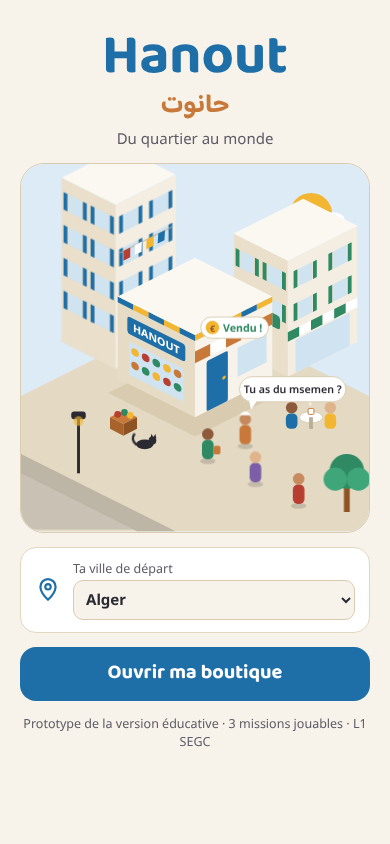
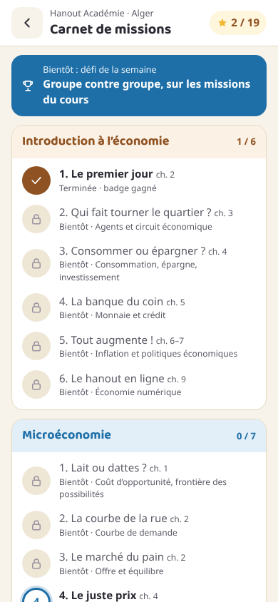
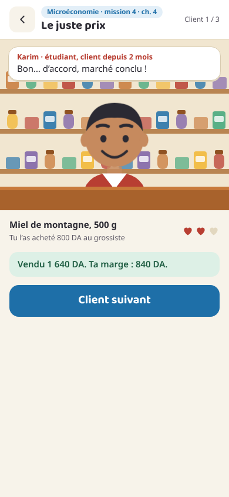
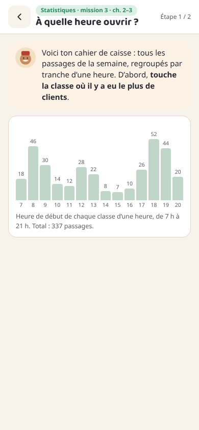
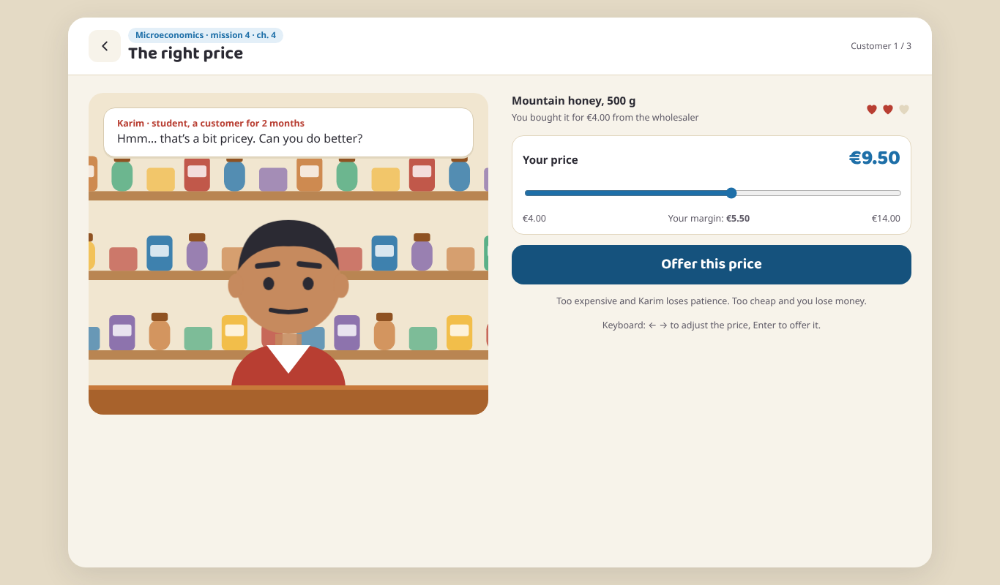

<p align="center"></p>

# Hanout · حانوت

**Du quartier au monde.** Hanout est un jeu éducatif de gestion : tu tiens un *hanout*, l’épicerie de quartier, et tu apprends l’économie en prenant de vraies décisions de commerçant.

Deux versions au choix, dès l’accueil :

- **Étudiant en économie** : chaque mission met en scène un chapitre de cours de L1 (*Statistics 1*, *Microeconomics 1*, *Introduction to Economics*), avec les notions, un quiz et des badges.
- **Grand public** : les mêmes situations en défis de commerçant, sans cours, avec un conseil d’Ammi Rabah et des étoiles selon ta performance.

Le jeu est en **français et en anglais**, et s’adapte au **téléphone comme à l’ordinateur**.

▶ **Jouer :** https://verty16yu.github.io/hanout/

| Accueil | Carnet de missions | Marchandage au comptoir | Histogramme |
| --- | --- | --- | --- |
|  |  |  |  |



## Le principe

Une mission dure 5 à 10 minutes et se joue toujours en quatre temps :

1. **Une situation** au hanout : un client, un voisin ou un événement pose un problème concret.
2. **Une décision** : un prix, un stock, un horaire. Aucune formule n’est donnée d’avance.
3. **Le résultat** : le quartier réagit, les chiffres apparaissent.
4. **La fin de mission avec Ammi Rabah**, l’ancien épicier. En version éducative : la notion est nommée, une question invite à réfléchir, puis deux questions de cours font gagner un badge. En version grand public : un conseil sans jargon et 1 à 3 étoiles.

## Mon hanout

Entre deux missions, ta boutique tourne toute seule, comme dans un jeu incrémental : tu sers des clients d’un geste, tu encaisses, puis tu achètes des améliorations (une étagère, le cousin au comptoir, un frigo à boissons, le pain du boulanger, un vélo de livraison). Chaque mission réussie ajoute 25 % à tous les gains, et la boutique continue à moitié régime pendant ton absence (8 heures au plus).

En version éducative, chaque amélioration montre la notion qu’elle illustre : recette marginale, rendements marginaux décroissants, investissement et délai de récupération, spécialisation et échange, taille du marché.

## Les missions du prototype

| Mission | Cours | Ce que tu apprends |
| --- | --- | --- |
| Intro 1 · Le premier jour | Introduction à l’économie, ch. 2 | Rareté, choix, coût d’opportunité |
| Micro 4 · Le juste prix | Microéconomie, ch. 4 | Disposition à payer, surplus du consommateur et du producteur |
| Stats 3 · À quelle heure ouvrir ? | Statistiques, ch. 2–3 | Classes, histogramme, classe modale |

Les 16 autres missions (élasticités, prix plafond, courbes d’indifférence, dispersion, inflation…) sont prévues dans la feuille de route.

## Pensé pour l’Algérie, ouvert au monde

- La ville de départ est proposée d’après le fuseau horaire du téléphone, sans géolocalisation : Alger, Oran, Constantine, Nanterre, Paris, Marseille, Casablanca ou Tunis.
- Les prix s’affichent en dinars, euros, dirhams ou dinars tunisiens.
- Français et anglais ; la version anglaise reprend les termes exacts des cours de HIS, donnés en anglais (*opportunity cost*, *consumer surplus*, *modal class*…). L’arabe est prévu.
- Le jeu est léger (environ 23 Ko compressés de JavaScript) pour tourner sur des téléphones d’entrée de gamme ; sur ordinateur, les écrans passent en deux colonnes et le comptoir se joue au clavier.
- Les animations se coupent si le téléphone demande moins de mouvement.

## Sous le capot

- **TypeScript + Vite**, sans framework, dessins en SVG (aucune image à télécharger).
- Les règles économiques sont séparées de l’affichage (`src/economie/`) et testées avec **Vitest**.
- Progression sauvegardée sur le téléphone (`localStorage`).
- Publication automatique sur **GitHub Pages** à chaque mise à jour de `main`.

```bash
npm install
npm run dev     # lance le jeu en local
npm test        # tests du moteur économique
npm run build   # version de production dans dist/
```

```
src/
  economie/   règles du jeu (premierJour, comptoir, histogramme, monnaie)
  i18n.ts     tous les textes, en français et en anglais
  missions/   les trois missions jouables
  ecrans/     accueil et carnet de missions
  ui/         dessins SVG, débrief et quiz, scène animée du quartier
  contenu/    liste des 19 missions et des modules
tests/        tests unitaires
```

## Feuille de route

- [x] **Phase 0 — Prototype** : 3 missions, une par module
- [ ] **Phase 1 — Version éducative** : les 19 missions, testées par le groupe 3 de L1 SEGC
- [ ] **Phase 2 — Grand public** : application Android, arabe, nouveaux défis
- [ ] **Phase 3 — Académie et monde** : espace enseignant, défis entre groupes, nouvelles villes

## Auteur

Projet conçu par **Mohamed Yanis Kireche**, étudiant en L1 SEGC (sciences économiques, de gestion et commerciales) à HIS, avec Claude (Anthropic) pour le code et les visuels.

---

## In English

**Hanout** is an educational business game: you run a *hanout*, a neighbourhood corner shop, and learn economics by making real shopkeeper decisions. Choose between an **economics student** version (missions mapped to first-year courses in Statistics, Microeconomics and Introduction to Economics, with quizzes and badges) and an **everyone** version (the same situations as shop challenges, with stars). Between missions, **My hanout** keeps your shop running like an idle game: serve customers, buy upgrades, and every mission you complete boosts your income. Available in French and English, on phone and desktop.

▶ **Play:** https://verty16yu.github.io/hanout/
